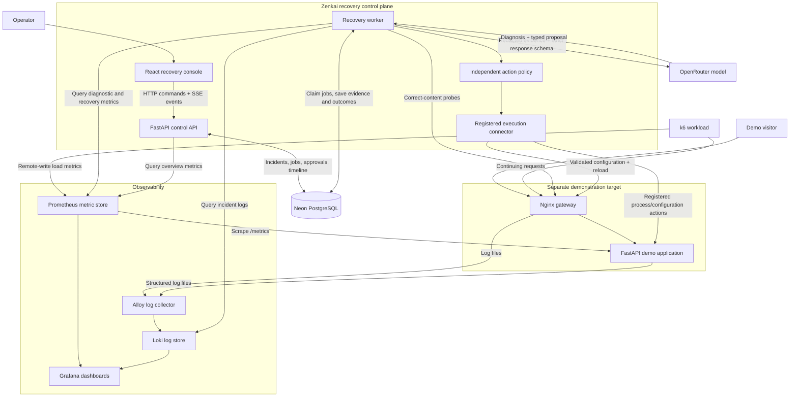
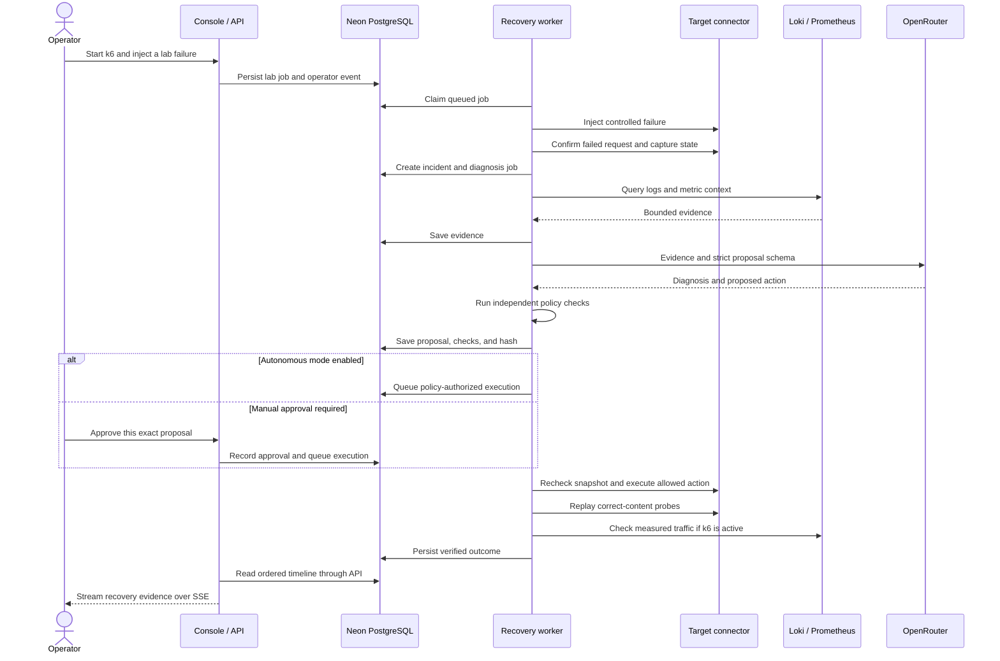
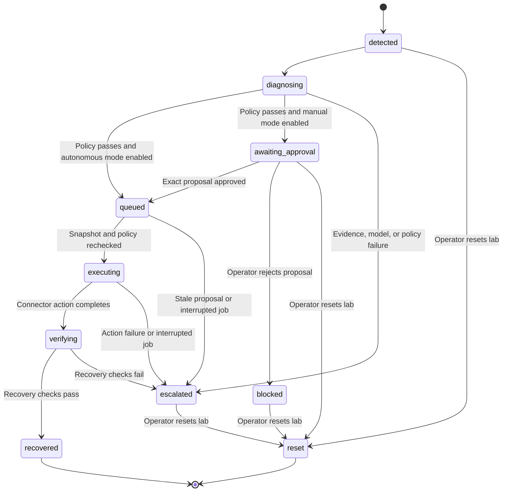

Built for UniHackathon@2026
**Live demo: [https://synapes-dev.online](https://synapes-dev.online)**

<p align="center">
  
</p>

<p align="center">
  <strong>AI-powered incident diagnosis and verified recovery for the services people depend on.</strong><br />
  A demonstration of AI-assisted incident diagnosis and verified recovery
</p>

<p align="center">
  <a href="#watch-the-demo">Video demo</a> ·
  <a href="#architecture">Architecture</a> ·
  <a href="#how-a-recovery-works">Recovery walkthrough</a> ·
  <a href="#run-locally">Run locally</a> ·
  <a href="#demo-guide">Demo guide</a> ·
  <a href="docs/live-verification.md">Live verification</a>
</p>

---

## Watch the demo

https://github.com/user-attachments/assets/5edfc1fb-8db7-4817-b7cf-fe6d81241b2a

The inline player shows the running console and separate demo target, failure injection, and the recovery workflow. Press play to start the three-minute recording.

## Try the live demo — no password needed

| Open | What to try |
| --- | --- |
| **[Zenkai recovery console](https://synapes-dev.online/)** | Failure lab, live incidents, evidence, approvals, and recovery controls |
| **[Separate demo target](https://demo.synapes-dev.online/campus)** | The fictional university portal that Zenkai monitors and repairs |
| **[Live Grafana dashboard](https://grafana.synapes-dev.online/d/zenkai-overview)** | Real request rates, latency, errors, and service logs |

**Visitors can explore and run the demonstration immediately. No account, sign-in, or password is required.** The home page includes a six-step walkthrough with shortcuts to the target, Failure lab, incidents, evidence, and live dashboard.

1. Open the console and demo target side by side.
2. In **Failure lab**, start the three-minute traffic test.
3. Inject **Broken upstream** and watch the demo target's requests fail.
4. Follow **Incidents** and **Evidence** as AI diagnoses the failure, policy validates the repair, and the worker verifies recovery.
5. Open **Observability** to inspect the same traffic and logs in Grafana. Try the other break cases one at a time, using **Reset lab** between scenarios.

This is a shared demonstration: visitors operate the same isolated target, so run one scenario at a time. Grafana dashboards and data exploration are available anonymously as a Viewer. AI/provider keys, database credentials, and internal lab tokens stay on the server. The existing action policy and exact-proposal approval checks still apply.

The temporary demo runs on EC2 with its own PostgreSQL database. The original local setup uses Neon PostgreSQL. A live cloud upstream-recovery run completed in **42.55 seconds**, with **260 measured requests and zero target errors** in the post-repair verification window while k6 continued running.

## Meet Zenkai

A university portal stops responding on a busy day. Students see an error, while the operations team has to find out whether the problem is a crashed application, a broken connection, a changed API response, or a capacity limit. The evidence lives across logs, metrics, configuration, and running services.

**Zenkai connects that evidence to a controlled recovery workflow.** It detects failed requests, collects relevant logs from Loki, asks an OpenRouter model for a structured diagnosis, validates the proposed action, and uses a registered connector to repair the target. It checks that real requests work again before recording recovery.

Zenkai is the independent recovery tool. The included **Northbridge University** website is a fictional, deliberately breakable demonstration target. University portals provide a relatable example; Zenkai does not manage student records, collect fees, or implement an ERP.

> **The recovery loop:** detect → gather evidence → diagnose with AI → validate → approve when required → execute → verify → record.

### What works in V1

- **Live recovery console:** target health, measured traffic and latency, incident history, evidence, proposals, approval controls, and connection readiness.
- **Four real failure scenarios:** broken upstream routing, API schema drift, a stopped application, and a reduced concurrency budget.
- **Working telemetry pipeline:** Alloy → Loki for logs; Prometheus for metrics; Grafana for dashboards; k6 for continuing test traffic.
- **Live AI diagnosis:** OpenRouter receives bounded, redacted evidence and returns a strict, evidence-linked action proposal.
- **Constrained execution:** independent policy checks, configuration snapshots, exact-proposal approvals, and registered operational handlers.
- **Durable orchestration:** Neon PostgreSQL stores incidents, jobs, proposals, checks, and ordered timeline events.
- **Measured recovery:** correct-content probes plus a traffic/error observation window when k6 is running.

**Verified with a live provider:** an upstream failure was diagnosed through OpenRouter and repaired with Neon persistence while k6 continued running. The recovery window contained **258 measured target requests and zero measured target errors**. See the [sanitized verification record](docs/live-verification.md) for the scope and timing. All four scenarios have also been exercised by the explicit fixture-model integration harness.

<details>
<summary><strong>See the interfaces</strong></summary>

### Zenkai recovery workspace


### Separate demonstration target


These screenshots show the running local V1. Their metric values are observations from that moment, not fixed product claims.

</details>

## Explore this guide

- [Architecture](#architecture) — services and their connections
- [How a recovery works](#how-a-recovery-works) — one incident from failure to recovery
- [AI proposals and execution policy](#ai-proposals-and-execution-policy) — what the model can propose and what can run
- [Failure lab](#failure-lab) — break cases and the blocked-action demonstration
- [Observability](#observability) — logs, metrics, dashboards, and load testing
- [State and orchestration](#state-and-orchestration) — persistence, jobs, approvals, and interruptions
- [Technology stack](#technology-stack)
- [Run locally](#run-locally) — configuration, startup, and access
- [Demo guide](#demo-guide) · [Verification](#verification)
- [Repository map](#repository-map) · [API overview](#api-overview)
- [Connecting another target](#connecting-another-target) · [Troubleshooting](#troubleshooting)
- [System alignment](#system-alignment) · [V1 boundaries](#v1-boundaries) · [Contributing](#contributing)

## Architecture

The system has three parts: **the target being protected**, **the recovery control plane**, and **the observability pipeline**. Neon supplies durable state; OpenRouter supplies model inference.



### Who owns what?

| Component | Responsibility | Important boundary |
| --- | --- | --- |
| **React console** | Displays health, incidents, evidence, policy checks, and operator controls | Uses a browser session and CSRF-protected commands; demo sessions open automatically |
| **FastAPI API** | Manages sessions, serves state/events, records approvals, and queues lab commands | Does not mount the Docker socket or perform container operations |
| **Recovery worker** | Detects failures, assembles evidence, requests diagnosis, and executes recovery jobs | Owns the recovery loop and checks its execution lease before actions |
| **Action policy** | Checks proposal shape, evidence references, targets, approved values, and stale configuration | Model output cannot authorize itself |
| **Execution connector** | Reads registered state and performs the four implemented operational actions | Fixed demo targets and handlers; no model-generated shell commands |
| **Neon PostgreSQL** | Persists incidents, jobs, evidence, proposals, preferences, and timeline events | Durable recovery state, separate from telemetry |
| **OpenRouter** | Runs the selected model against supplied evidence | Returns a proposal; has no direct Docker, database, or shell access |
| **Alloy + Loki** | Collect and store log evidence used in diagnosis | Logs are treated as untrusted data |
| **Prometheus + Grafana** | Store numerical measurements and display logs/metrics | Dashboards explain behavior; the worker performs recovery |
| **Demo target + k6** | Produce real requests, failures, and recovery observations | Isolated fictional environment for repeatable demonstrations |

The console and target use separate Nginx containers. They share a built frontend image, but have different routes and backend services. Breaking the target's gateway is separate from using the recovery console.

## How a recovery works

Consider a gateway that should forward requests to the application's registered port, `8000`. The failure lab changes that upstream to `8999`, producing genuine failed requests.

1. **Detect the interruption.** The worker requests `/api/portal` through the gateway. A healthy response must return HTTP 200 and the expected `northbridge-portal-v1` signature. A second failed probe confirms the incident. The normal worker polling interval is three seconds; V1 detection starts from HTTP probes, with logs and metrics supplying context.
2. **Preserve the facts.** Zenkai saves the observed failure and a snapshot of registered gateway/application state, then creates a durable diagnosis job. One active incident is allowed for the demo target.
3. **Collect relevant evidence.** The worker queries a 90-second Loki window, keeps at most 60 matching log entries, and adds request-rate metrics, the probe result, and configuration. Each item receives an evidence ID. Known secrets are redacted before the model request.
4. **Ask the model for a diagnosis.** OpenRouter receives the evidence and allowed action schema. The model must identify a likely cause, cite evidence IDs, choose a supported action, and describe verification. Missing credentials, provider errors, malformed responses, or absent Loki evidence stop the repair path and escalate the incident.
5. **Validate independently.** Policy checks that the action is `restore_upstream` on `gateway`, the proposed port is exactly `8000`, cited evidence exists, and unrelated mutation fields are empty. Zenkai also checks that the registered backend is reachable.
6. **Authorize the exact proposal.** With autonomous mode enabled, an allowed demo action is queued automatically. Otherwise an operator must approve its exact proposal hash, which binds the proposal to its configuration snapshot.
7. **Recheck and execute.** The worker rereads target state and rejects a stale snapshot. The connector writes the allowed gateway configuration, runs `nginx -t`, and reloads Nginx. The gateway handler restores the previous configuration if validation/reload fails.
8. **Prove the request works again.** After a five-second settling delay, five correct-content probes run at two-second intervals. Each must be healthy and finish within 1,500 ms. If k6 is still running, the worker also requires at least 20 measured application requests and an error ratio no greater than 5% in the trailing ten-second window.
9. **Record the outcome.** Only after those checks does the incident become `recovered`. PostgreSQL stores the outcome, probe observations, load-verification flag, measurements, and elapsed time. The console receives the new timeline events.

When k6 is inactive, V1 can complete a **probe-only recovery**, recorded with `under_load: false`. Use continuing k6 traffic for the full under-load demonstration; probe-only recovery does not establish recovery under load.



## AI proposals and execution policy

The AI contribution is **evidence-based diagnosis and action selection**. The deterministic control layer decides whether a proposed mutation is executable. Returning a convincing paragraph is insufficient.

An illustrative upstream proposal looks like this; evidence IDs must correspond to the actual captured bundle:

```json
{
  "root_cause": "The gateway points to port 8999 instead of the registered backend port 8000.",
  "evidence_ids": ["configuration", "log-0"],
  "action": "restore_upstream",
  "target": "gateway",
  "upstream_port": 8000,
  "schema_field": null,
  "capacity": null,
  "verification_plan": "Replay correct-content requests and check errors while k6 traffic continues."
}
```

The response uses strict JSON Schema and Pydantic validation, including rejection of extra fields. OpenRouter receives `provider.require_parameters: true`. The default model is **`nvidia/nemotron-3.5-super-vl:free`**; `OPENROUTER_MODEL` selects it independently of the generic API key. Availability, free-tier limits, and structured-output support depend on the provider. A replacement model needs the same contract checks and scenario verification.

### Execution gates

| Gate | What it enforces |
| --- | --- |
| Evidence references | Every cited ID must exist in the bundle; reference validity does not prove every model inference is correct |
| Action and target allowlist | Only the four implemented action types and their registered targets are accepted |
| Mutation limits | Port `8000`, the observed `services`/`offerings` mapping, capacity `24`, or starting the stopped registered service |
| Unrelated-field rejection | An allowed action cannot include additional parameter changes |
| Snapshot and proposal hash | Configuration must still match the state that was diagnosed and approved |
| Operator approval | Manual review is bound to the exact proposal hash; approval cannot override forbidden values |
| Connector checks | Registered container identity, portal configuration revisions, and action-specific readiness/configuration checks |
| Post-action verification | Correct response content and latency, plus measured requests/errors when load is active |

The model cannot change student records, payment amounts, academic decisions, arbitrary files, or SQL. V1 repairs infrastructure/configuration through predefined handlers. Its schema-mapping action is a constrained adapter configuration patch; it does not generate or execute unrestricted source-code patches.

## Failure lab

The **Failure lab** queues operator-requested faults into the worker. They alter the actual demo environment; the console does not simulate success by changing a status label.

| Scenario | Injected change | Visible failure | Allowed recovery |
| --- | --- | --- | --- |
| **Broken upstream** | Point Nginx at backend port `8999` | Gateway errors; connection-refused evidence | Restore registered port `8000`, test configuration, reload |
| **API schema drift** | Provider switches to `offerings` while the adapter expects `services` | Requests return a schema error | Set the adapter field to the observed provider contract |
| **Application crash** | Kill the demo application's container process | Application unavailable through the gateway | Start the registered stopped service and verify responses |
| **Capacity exhaustion** | Reduce concurrency budget from `24` to `2` | Requests rejected under k6 traffic | Restore the fixed approved budget of `24` |

Capacity exhaustion is a controlled application condition. It demonstrates recovery from rejections; it is not a production-server saturation benchmark or automatic cloud scaling.

Two additional controls explain the boundaries:

- **Unsafe proposal:** explicitly injects a forbidden candidate into the validator. It must be blocked without infrastructure changes. This demonstrates the validator, not a claim that the live model produced that candidate.
- **Reset lab:** manually restores known-good configuration and labels open incidents `reset`. It is recorded as an operator reset and does not count as an AI recovery.

Run one scenario at a time and reset between demonstrations.

## Observability

| Tool | Data path | How Zenkai uses it |
| --- | --- | --- |
| **Alloy** | Reads shared demo log files and forwards lines to Loki | Collects evidence without model access to the host filesystem |
| **Loki** | Stores application and gateway logs | Worker queries recent error-related lines; Grafana displays logs |
| **Prometheus** | Scrapes metrics every five seconds and accepts k6 remote write | Supplies overview charts, diagnostic context, and recovery measurements |
| **Grafana** | Reads provisioned Loki and Prometheus data sources | Shows the service-recovery dashboard and supports investigation |
| **k6** | Sends continuing requests through the target gateway | Makes failures and recovery observable under repeatable traffic |

The target emits `zenkai_portal_requests_total` with an `outcome` label and the `zenkai_portal_request_seconds` histogram. Logs hold detailed messages; PostgreSQL holds the recovery audit trail. These stores serve different purposes.

Useful queries in Grafana Explore:

```logql
{service_name="zenkai-demo"} |~ "(?i)(error|failed|refused|capacity|schema|crash)"
```

```promql
sum(rate(zenkai_portal_requests_total[1m])) by (outcome)
```

```promql
histogram_quantile(0.95, sum(rate(zenkai_portal_request_seconds_bucket[1m])) by (le))
```

### What the load test proves

The default workload is **25 offered requests/second for three minutes**, using k6's constant-arrival-rate executor. It checks HTTP status and the expected response signature. The script preallocates 110 virtual users, allows up to 128, and requires **zero dropped iterations**.

Injected outages produce failed response checks, which remain visible in whole-run results. Zenkai evaluates the post-repair window separately. A full demonstration shows **baseline → failure → recovery while traffic continues**.

The summary is written to `/results/latest.json` in the load-results volume. Once the workload has produced it, copy it into the ignored local work directory:

```bash
mkdir -p work
docker cp zenkai-load:/results/latest.json ./work/k6-latest.json
```

See [the observability guide](observability/README.md) for readiness, collection checks, and retention details.

## State and orchestration

Neon PostgreSQL is the durable incident store and job queue. The API submits work; a separate Python worker executes it. V1 does not require Redis, Celery, or an agent framework.

| Table | Contents |
| --- | --- |
| `incidents` | Status, timestamps, evidence, target snapshot, proposal/hash, model ID, validation checks, and errors |
| `timeline` | Ordered detection, evidence, proposal, validation, approval, execution, recovery, reset, and escalation events |
| `jobs` | Queued operations, status, attempts, execution lease, unique action key, and failures |
| `preferences` | Autonomous-mode setting, worker ownership/heartbeat, and observed load state |

Approval history lives in timeline events rather than a separate approval table.

### Incident lifecycle



`proposed` and `validated` are timeline events within diagnosis, rather than separate stored incident statuses. Reset can clear an open incident; the diagram highlights common paths.

### Execution consistency

- Jobs are claimed transactionally with PostgreSQL `FOR UPDATE SKIP LOCKED`.
- A single worker ownership lease coordinates the V1 target. Heartbeats renew it, and execution checks ownership before new actions.
- Proposal hashes serve as unique execution action keys, preventing duplicate approval requests from creating duplicate jobs.
- Expired running jobs become **uncertain**, and associated incidents escalate. Mutations with unknown outcomes are not blindly replayed.
- Transactions stay short; model calls, network requests, and Docker operations happen outside database transactions.

These mechanisms provide guarded execution and durable history, not an exactly-once guarantee across PostgreSQL and Docker. V1 attempts a recovery and escalates failures; it does not implement an unlimited retry loop or general rollback engine.

## Technology stack

| Layer | Choice | Purpose |
| --- | --- | --- |
| Frontend | Vite, React, TypeScript | Responsive operator interface and separate demo page |
| Client state and visuals | TanStack Query, Recharts, Lucide, custom CSS | Live data, measured charts, readable controls |
| API and validation | Python 3.12, FastAPI, Uvicorn, Pydantic v2 | Typed commands, sessions, strict proposals, and SSE |
| HTTP integrations | HTTPX | Telemetry queries, target probes, and OpenRouter calls |
| Database | Neon PostgreSQL | Durable incidents, jobs, and audit events |
| Persistence tooling | SQLAlchemy async, Psycopg 3, Alembic | Small connection pools, PostgreSQL access, and migrations |
| Orchestration | Separate Python asyncio worker | Detection, diagnosis, guarded execution, and verification |
| AI inference | OpenRouter, configurable model | Evidence-linked diagnosis and action selection |
| Execution | Docker SDK, registered Python handlers, Nginx | Controlled process and configuration operations |
| Logs | Grafana Alloy + Loki | Collection and searchable incident evidence |
| Metrics | prometheus-client + Prometheus | Request outcomes, latency, and recovery measurements |
| Dashboards | Grafana | Provisioned metrics and log views |
| Load testing | Grafana k6 | Bounded traffic continuing through failure and repair |
| Local deployment | Docker Compose, uv, pnpm | Pinned images and committed dependency lockfiles |

## Run locally

For a dedicated temporary cloud host with custom-domain HTTPS, see the
[EC2 deployment guide](docs/deployment.md). It uses separate database state
so the cloud worker cannot interfere with a running local demonstration.

### 1. Prerequisites

- Docker Engine with the Docker Compose plugin and access to the local Docker daemon.
- Node.js compatible with the pinned Vite version; **Node 24** was used for the local build.
- **pnpm 11.25.0**, matching `frontend/package.json`.
- **uv** and Python 3 for the initializer. Startup asks uv to provision/use **Python 3.12**.
- Neon PostgreSQL and an OpenRouter API key for the full recovery loop.
- Internet access to pull dependencies/images and reach Neon/OpenRouter.

Run the commands below from the repository root.

### 2. Clone and initialize

```bash
git clone https://github.com/arnavsx3/Zenkai.git
cd Zenkai
python3 scripts/init_local.py
```

The initializer creates an ignored `.env`, preserves existing values, generates missing local secrets, and restricts the file's permissions. It does not print credentials. [.env.example](.env.example) lists the fields.

Add these values in your local `.env`:

```dotenv
DATABASE_URL=<Neon pooled PostgreSQL connection URL with TLS>
DATABASE_URL_UNPOOLED=<Neon direct PostgreSQL connection URL with TLS>
OPENROUTER_API_KEY=<your OpenRouter API key>
OPENROUTER_MODEL=nvidia/nemotron-3.5-super-vl:free
```

Keep credentials in `.env`; do not put them in frontend code, screenshots, or commits.

| Setting | Purpose |
| --- | --- |
| `DATABASE_URL` | Pooled Neon URL for the API and worker |
| `DATABASE_URL_UNPOOLED` | Direct Neon URL for Alembic migrations |
| `OPENROUTER_API_KEY` | Server-side authorization for model requests |
| `OPENROUTER_MODEL` | Model identifier sent with each diagnosis |
| `OPERATOR_PASSWORD` | Used only when password mode is enabled (`DEMO_ACCESS=false`) |
| `DEMO_ACCESS` | Compose defaults to `true`: password-free demo controls and anonymous Grafana viewing |
| `SESSION_SECRET` | Signs the operator session |
| `LAB_TOKEN` | Authenticates the demo application's internal configuration endpoints |
| `GRAFANA_ADMIN_PASSWORD` | Generated maintenance credential; visitors need no password to view or explore dashboards |
| `AUTO_APPROVE_SAFE` | Initial autonomous-mode default; console changes persist in PostgreSQL |
| `TARGET_NAME` | Display name for the registered demo target |
| `LOKI_SELECTOR` | Stream selector; defaults to `{service_name="zenkai-demo"}` |

Both database connections should require TLS. Runtime pools are intentionally small; migrations prefer the direct URL. Compose supplies internal service names for telemetry endpoints. Advanced endpoint configuration belongs in backend/Compose settings.

### 3. Build and start

```bash
bash scripts/start.sh
```

This installs locked dependencies, builds the frontend and application images, prepares the k6 image, and starts default services. The load generator starts separately from the Failure lab or the `load` profile.

### 4. Apply the database schema

```bash
docker compose run --rm api alembic upgrade head
docker compose up -d --force-recreate api worker
docker compose ps
```

Run migrations on first setup and after migration changes. Recreate API/worker containers after editing `.env` so they receive updated values.

Without external credentials, the target and observability services can still start. The full recovery loop requires Neon/OpenRouter configuration and a migrated database. Missing setup is shown in the console rather than replaced with fabricated AI results.

### 5. Open the services

| Service | Local address | Access |
| --- | --- | --- |
| **Zenkai console** | [localhost:5173](http://localhost:5173) | No password in default demo mode; controls and diagnostic evidence open automatically |
| **Separate demo target** | [localhost:8080/campus](http://localhost:8080/campus) | Fictional university page |
| **Grafana dashboard** | [localhost:3300/d/zenkai-overview](http://localhost:3300/d/zenkai-overview) | No password; anonymous dashboard and data viewing |
| **Prometheus** | [localhost:9090](http://localhost:9090) | Local metrics explorer |
| **API documentation** | [localhost:8000/docs](http://localhost:8000/docs) | Endpoint schemas and reference |
| **Loki readiness** | [localhost:3100/ready](http://localhost:3100/ready) | Log-store readiness |
| **Alloy** | [localhost:12345](http://localhost:12345) | Collector status |

Published ports bind to `127.0.0.1`. In default demo mode, the API creates an HttpOnly browser session automatically and retains CSRF-protected mutations. No password prompt is needed. Set `DEMO_ACCESS=false` and recreate API, worker, and Grafana to restore password-based access outside the open demo. The raw Python API settings default to password mode unless demo mode is explicitly enabled by the environment.

### Stop and resume

```bash
docker compose stop load
docker compose down
# Later, start the existing stack again:
docker compose up -d
```

Normal shutdown preserves named volumes. Adding `-v` to `docker compose down` deletes local telemetry, dashboard data, target configuration, and load results. It does not delete Neon data or host log files.

## Demo guide

1. **Establish the baseline.** Open Zenkai and the demo target side by side. Check **Connections**, and confirm the worker/database are ready and the target returns correct content.
2. **Start traffic.** In **Failure lab**, start the default three-minute k6 workload. Confirm measured requests in Zenkai or Grafana.
3. **Break the target.** Inject **Broken upstream** for the main demonstration. Refresh the demo page to show an actual failed service request.
4. **Show the evidence.** In **Incidents**, follow detection and diagnosis. Inspect the Loki evidence, registered state, and model proposal.
5. **Explain the AI boundary.** Show the root-cause explanation, cited evidence, selected action, and independent checks.
6. **Show authorization.** Autonomous mode queues allowed actions automatically. For a separate approval demonstration, disable it **before injecting a new fault**, then review and approve the proposal.
7. **Watch the comeback.** Keep k6 running. Show execution, correct-content probes, measured traffic/errors, and the final outcome.
8. **Show the guardrail.** Use the explicitly labelled unsafe-proposal control and show the rejected mutation.
9. **Inspect and reset.** Review Grafana and the persisted timeline, then reset before another scenario. Stop the workload when finished.

A free model may be slow or rate limited. If k6 finishes before verification, the record identifies probe-only recovery. Use a fresh workload and scenario to demonstrate recovery under continuing traffic; retain escalated incidents as evidence of what happened.

## Verification

### Recorded results

| Check | Recorded result | Scope |
| --- | --- | --- |
| Backend suite with disposable PostgreSQL | **20 tests passed** | Policy, auth/CSRF, portal behavior, model contract, jobs, and approvals |
| Backend suite without test PostgreSQL | **17 passed, 3 skipped** | Database-specific tests require explicit configuration |
| Frontend production build | **Passed** | TypeScript check and Vite build |
| Four-scenario container harness | **All four recovered; 2,464 requests; zero dropped k6 iterations** | Real Docker/Loki/Prometheus/k6; labelled fixture model and disposable database |
| Live upstream repair | **63.02 seconds; 258 measured recovery-window requests; zero measured errors** | Live Neon and NVIDIA/OpenRouter; one upstream scenario under continuing k6 traffic |

These are recorded V1 observations, not production capacity guarantees or a broad model benchmark. [The live verification record](docs/live-verification.md) documents the provider-backed run separately from the fixture-based harness.

### Standard checks

```bash
uv sync --frozen --python 3.12
uv run pytest -q
pnpm --dir frontend install --frozen-lockfile
pnpm --dir frontend build
docker compose config --quiet
```

PostgreSQL tests require `TEST_DATABASE_URL` for a **disposable local database named `zenkai_test`**. Their URL guard prevents using the application database. Never point these tests at Neon or valuable data.

### Full recovery harness

[The container verification harness](scripts/verify_lab.py) requires the isolated `zenkai-test-db/zenkai_test` database, a migrated test schema, and execution within the lab's Docker network with the connector's volumes and Docker access. It uses an explicitly labelled model fixture inside the test process; the running application never silently substitutes fixture responses.

Stop the regular worker while running this harness because both operate on the same demo target. Restart it afterward, including after a failure. The harness tests all four faults using real target operations and telemetry, requires zero dropped k6 iterations, and checks measured recovery windows. Consult [the script](scripts/verify_lab.py) and [database tests](backend/tests/test_postgres.py) before preparing the isolated environment.

## Repository map

```text
Zenkai/
├── README.md                         # Project, architecture, setup, and demonstration
├── CONTRIBUTING.md                   # Commit cadence and recovery invariants
├── compose.yaml                      # Control plane, target, and observability services
├── .env.example                      # Configuration template; no live credentials
├── pyproject.toml / uv.lock           # Python dependencies and lockfile
├── backend/
│   ├── src/zenkai/
│   │   ├── api.py                    # Sessions, state, SSE, approvals, queued commands
│   │   ├── worker.py                 # Detection, diagnosis, execution, verification
│   │   ├── intelligence.py           # Evidence collection and OpenRouter client
│   │   ├── domain.py                 # Proposal schema, policy, hashes, redaction
│   │   ├── connector.py              # Registered Docker/configuration actions
│   │   ├── db.py                     # Durable state and transactional job claims
│   │   ├── portal.py                 # Separate faultable demo application
│   │   ├── bootstrap.py              # Gateway and k6 volume initialization
│   │   ├── config.py                 # Typed server-side settings
│   │   └── logging.py                # Structured log output
│   ├── migrations/                   # Alembic database schema
│   └── tests/                        # Policy, API, portal, model, and PostgreSQL tests
├── frontend/
│   ├── src/                          # Recovery console and separate demo page
│   ├── nginx.conf                    # Console routing and control API proxy
│   └── package.json / pnpm-lock.yaml  # Frontend dependencies and lockfile
├── loadtests/traffic.js               # Bounded k6 request workload
├── observability/                    # Alloy, Loki, Prometheus, Grafana configuration
├── scripts/
│   ├── init_local.py                 # Environment and local secret initialization
│   ├── start.sh                      # Build and start the local stack
│   └── verify_lab.py                 # Explicit four-scenario integration harness
└── docs/
    ├── assets/                       # README artwork and interface screenshots
    └── live-verification.md          # Sanitized live-provider verification record
```

## API overview

[The local OpenAPI page](http://localhost:8000/docs) contains complete schemas. The console uses same-origin API routing. Timeline updates use Server-Sent Events with persisted event IDs for reconnection.

| Route | Purpose | Access |
| --- | --- | --- |
| `GET /api/health` | Control API health | Public local endpoint |
| `GET /api/session` | Session state and CSRF token | Creates a session automatically in demo mode |
| `POST /api/login` | Create an operator session in password mode | Unnecessary in demo mode |
| `POST /api/logout` | End the session | Operator + CSRF |
| `GET /api/state` | Overview, incidents, timeline, worker/load/setup state | Full demo evidence available without a password in demo mode |
| `GET /api/events` | Stream ordered timeline events | Operator session |
| `POST /api/lab` | Queue a fault, reset, or load start/stop command | Operator + CSRF |
| `POST /api/incidents/{incident_id}/approval` | Approve/reject an exact proposal hash | Operator + CSRF |
| `POST /api/autopilot` | Change autonomous-mode preference | Operator + CSRF |
| `POST /api/unsafe-proposal` | Run the injected invalid-proposal check | Operator + CSRF |

In demo mode, call `GET /api/session` once and retain its cookie and returned CSRF token to call the session-protected API routes below without a password. The console handles this automatically.

The target's `/api/portal`, `/health`, `/metrics`, and token-protected internal configuration endpoints belong to the separate demo application, not the control API.

## Connecting another target

The architectural boundary is reusable; the shipped connector is specific to the isolated demo. A new authorized target needs:

1. **Telemetry:** a reachable Loki log stream and appropriate Prometheus metrics.
2. **An inventory snapshot:** registered services, configuration revisions, and approved operational limits.
3. **A request contract:** endpoint, expected response content, latency budget, and recovery checks.
4. **A scoped connector:** named operations the worker may execute against that infrastructure.
5. **Matching policy and tests:** action schemas, permitted values, approval rules, and failure/recovery scenarios.

`TARGET_NAME` changes the display name and `LOKI_SELECTOR` selects a log stream. They do not implement an integration with an arbitrary portal. Vendor-specific adapters, multi-target administration, and remote fleet agents are future work.

The worker uses the Docker socket to operate registered local containers. It is a trusted component: container-label checks constrain application behavior, while Docker daemon access itself grants broad host authority. The socket is mounted only into the worker. Production connectors would need infrastructure-specific permissions and deployment hardening.

## Troubleshooting

| Symptom | Check or next step |
| --- | --- |
| Database configured but not ready | Check Neon connectivity/TLS and run the migration through the API container. Credential presence alone does not prove a working schema. |
| Credentials still appear missing after editing `.env` | Recreate API/worker containers so they receive the new values. |
| No Loki evidence reaches diagnosis | Check Alloy/Loki readiness, log collection, and `LOKI_SELECTOR`. Diagnosis refuses to invent a log-backed repair. |
| OpenRouter error or timeout | Inspect the escalated incident; check the key, model, quota, and structured-output compatibility. Key presence is not a provider health check. |
| Proposal blocked as stale | Target configuration changed after diagnosis. Inspect/reset the lab and create a fresh incident. |
| Cannot inject a new fault | Check for a queued/running command or active incident. Finish the operation or explicitly reset the lab. |
| Healthy target but failed verification | Check expected content, latency, k6 state, measured traffic, and errors. A running process alone does not prove recovery. |
| Grafana rejects a newly edited password | Its existing volume preserves the original account password; `.env` changes do not reset that account. |
| Frontend source changes do not appear | Build frontend assets, rebuild the `console` image, and recreate affected `console`/`gateway` containers; the runtime image copies built assets. |
| Worker appears offline | Check database readiness, the running service, and worker logs. New actions require a valid ownership lease. |

Useful local diagnostics:

```bash
docker compose ps
docker compose logs --tail=80 api worker
docker compose logs --tail=50 alloy loki prometheus
docker compose exec prometheus promtool check config /etc/prometheus/prometheus.yml
docker compose exec alloy alloy validate /etc/alloy/config.alloy
```

Inspect diagnostics locally and redact sensitive content before sharing. See [observability/README.md](observability/README.md) for collection checks and service-specific details.

## System alignment

| System requirement | Demonstrated implementation |
| --- | --- |
| Monitor workflows and detect errors/unexpected outcomes | Repeated correct-content probes detect failure of the target's request-serving workflow |
| Analyze logs or execution data for likely cause | Loki logs, Prometheus context, probe observations, and registered configuration feed the model |
| Recommend or generate corrective action | Typed, evidence-linked actions and constrained configuration/payload-mapping parameters |
| Validate fixes before execution | Schema, target/value allowlists, evidence references, revisions/hashes, and action-specific checks |
| Human approval where necessary | Exact-proposal review with autonomous mode disabled; prohibited mutations remain blocked |
| Retry the failed process and verify recovery | Replayed correct-content requests and measured recovery windows under continuing k6 traffic |
| End-to-end failure injection and successful recovery | Four controlled faults, separate target application, durable timeline, and recorded outcomes |

## V1 boundaries

- **Single registered local target.** Connecting a real university requires its authorized telemetry and operational connector.
- **Four supported action types.** The model diagnoses within this recovery space. Arbitrary code repair, cloud provisioning, and business-data mutation are outside V1.
- **One recovery attempt before escalation on failure.** There is no general exponential-backoff system, fleet scheduler, or distributed exactly-once guarantee.
- **Local deployment.** Ports are loopback-only; Loki has no authentication in this stack. HTTPS deployment, organization accounts, full RBAC, and production secret management remain future work.
- **External inference.** Known credentials are redacted; production connectors also need their own data-minimization and personal-data controls before sending logs to a provider.
- **Explicit verification scope.** One upstream scenario has live-model verification; the four-case harness uses a labelled fixture. Load-backed and probe-only recoveries are distinguished.
- **Demo-scale storage.** Prometheus retains three days; Loki has no automatic cleanup policy. Use limited fictional telemetry and configure retention before broader deployment.

## Contributing

Read [CONTRIBUTING.md](CONTRIBUTING.md) and [AGENTS.md](AGENTS.md). Finish one coherent change, verify the affected behavior, use a Conventional Commit message, and push before the next milestone. Preserve the recovery invariants and keep credentials, student data, local database files, and generated telemetry out of Git.

**The bigger vision:** connected services that explain a failure, recover within explicit operational boundaries, and show the evidence that they are working again.
